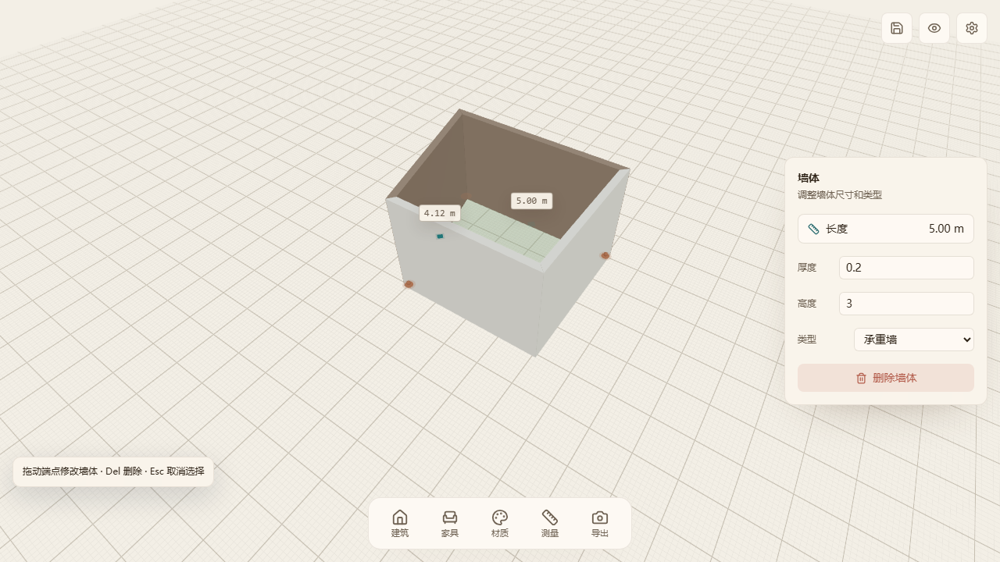
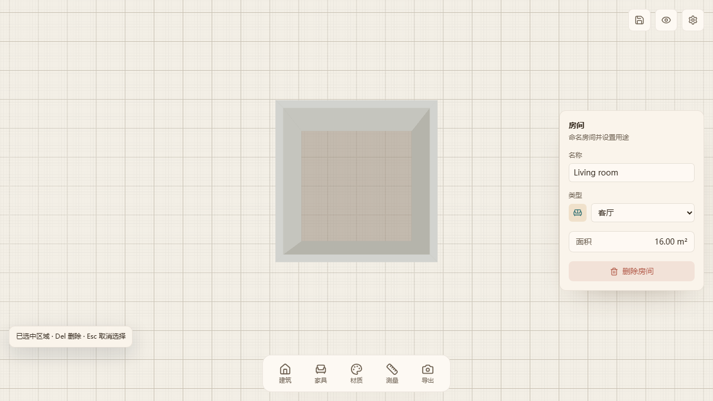

# V4 Browser Acceptance - 2026-10-23

## Scope

Accept the existing professional editing phase 1/2 implementation from
`codex/professional-editing-ux@7394d76`, integrated with
`main@be761d9`. Browser gestures, final document topology, persistence and
visual feedback are checked together.

The test fixture seeds only the initial document and camera through the
development debug bridge. Edits use Playwright mouse and keyboard input against
the actual WebGL canvas and HTML controls. There are no retries enabled.

## Accepted behavior

| Capability | Browser assertions |
| --- | --- |
| Selection and multiselection | Unlocked canvas clicks select walls; Shift-click adds/removes walls; Escape clears selection. |
| Endpoint dragging | Grid snapping, live dimension preview, commit, connected-wall selection and zone identity. |
| Drag cancellation | Escape leaves the document unchanged for both vertex and wall drags. |
| Split wall | Clicking the visible midpoint creates two wall segments, selects the split vertex and preserves the room. Dimension labels do not cover the handle. |
| Wall body dragging | Length is preserved, both endpoints and adjacent walls update, and the drag plane follows the grabbed elevation. |
| Numeric vertex editing | Tab focuses coordinates; releasing the mouse does not commit; Enter commits the typed coordinates; Escape cancels. |
| Numeric wall editing | Tab accepts a precise normal offset without premature mouse-release commit. |
| Room properties | Name/type remain attached to the same room; area updates from 12 to 16 square meters after wall editing. |
| Numeric wall drawing | The building tool accepts a typed 3.5 m wall length. |
| Endpoint snapping | Snapping to an existing endpoint repairs the graph without dangling wall vertices. |
| Oblique camera | Endpoint handles and body drags work from a perspective view, with accurate final coordinates. |
| Persistence | A dragged vertex survives IndexedDB save and editor reload. |
| Navigation | Editing clicks leave the pointer unlocked; the browse button enters FPS navigation; Alt temporarily unlocks and releasing Alt relocks. |

## Repairs

- Make the full-screen UI shell transparent to pointer events between its panels.
- Use explicit navigation entry handlers and native pointer-lock synchronization.
  Camera controls no longer auto-lock arbitrary editing clicks or center all
  unlocked hit tests. Entry succeeds even before camera control effects finish.
- Give handles overlay rendering and hit priority over wall geometry.
- Use the original grabbed elevation for wall-body drag coordinates.
- Freeze drag pointer movement/release during numeric input.
- Add a native submit button for the two-field coordinate form and cancel the
  entire numeric drag on Escape.
- Move dimension labels away from midpoint handles.
- Enable effective TypeScript validation via `tsc -b`. Correct existing stale
  types, test fixtures, React refs and missing exports/imports, and remove
  unreferenced private geometry helpers. The active geometry algorithms are
  unchanged.

## Validation

- `npm run test:e2e -- --workers=2 --reporter=dot`: **24 passed**, including
  **14 new V4 acceptance tests**, on Chromium.
- Pointer-lock entry regression repeated eight times: **8 passed**.
- `npm run test:unit -- --run --maxWorkers=4`: **49 files / 248 tests passed**.
- `npm run lint`: passed, checking both referenced TypeScript projects.
- `npm run build`: passed.
- `git diff --check`: passed.
- Screenshots of drag preview, split wall, numeric input, room properties and
  oblique editing were captured for visual inspection.
- Root-checkout preservation was checked against the pre-task file-status and
  SHA-256 manifest. All **44 original changed/untracked file entries** were
  unchanged. The original checkout remains at `42c4fc9`; work was isolated under
  `.worktrees/v4-browser-acceptance-20261023`.

## Screenshots

## Limits and remaining roadmap

This accepts the already implemented V4 phase 1/2 features. Architecture
undo/redo, dedicated offset/trim/extend tools, continuous-drawing improvements
and simultaneous multi-vertex drag are not added by this change. Doors/windows,
complete residential semantics and export/share delivery remain later work.

Browser acceptance was run on Chromium; Firefox, WebKit and mobile/touch are
not covered by this run. The existing large Three.js vendor-chunk warning
remains non-fatal.
