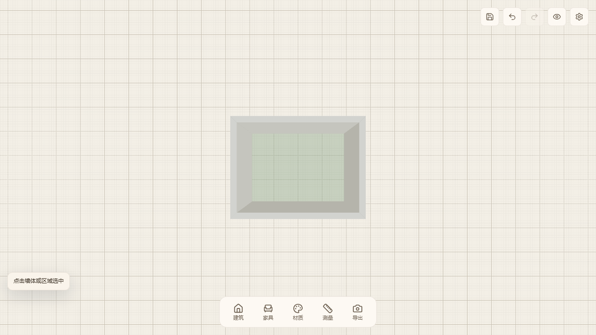

# V4 Architecture Undo/Redo

## Milestone

Add bounded, session-local history for the existing V4 architecture document.
Drawing, splitting, deleting, committed vertex/wall drags and property edits
must undo and redo with exact topology, entity IDs and room metadata restored.
This milestone does not add the remaining offset/trim/extend tools.

## Design

- Keep architecture history separate from the legacy furniture timeline.
- Capture immutable document snapshots at the existing replaceDocument commit
  boundary. Drag previews do not change the document and produce no history.
- Retain up to 100 committed edits, ignore identical replacements, and clear
  redo when a new edit branches from an undone state.
- Coalesce each focused wall numeric field or room-name editing session into
  one step. Returning to the original value preserves the existing timeline.
- Ctrl/Cmd+Z undoes; Ctrl/Cmd+Shift+Z and Ctrl/Cmd+Y redo. Native text-field,
  textarea, select and contenteditable behavior takes precedence.
- History actions first cancel an active drawing/dragging preview. A subsequent
  action traverses committed history. Clear stale selection/hover afterward.
- Provide disabled/enabled undo and redo buttons beside Save.
- Loading a saved document resets history. Undo/redo results use the existing
  autosave path. A late load must not replace edits made after loading began.

## Acceptance

- Unit coverage: ordering, branching, no-ops, capacity, grouping, reset/load,
  snapshot isolation, preview cancellation and keyboard input boundaries.
- Chromium: real mouse/keyboard draw, drag, split, delete, grouped property edits,
  redo aliases, branch invalidation, preview cancellation and reload baseline.
- Run the existing browser suite, unit suite, production build and real
  TypeScript checks. Preserve the original root checkout and its pending work.

## Verified result

- Chromium full regression: 31 tests passed, including seven architecture
  history scenarios. The completed-wall undo/redo and exact-ID split scenarios
  also passed focused runs after extending their coverage.
- Unit regression: 51 files / 268 tests passed, including delayed-load handling,
  editable-field shortcut boundaries and exact topology/metadata restoration.
- Production build, TypeScript checks and whitespace checks passed. The existing
  Three.js vendor-size warning remains.
- Manual preview uses port 3001 to keep the original port-3000 session available.
- History is kept in memory for this editing session; document persistence keeps
  using the existing IndexedDB format without storing the undo stack.

