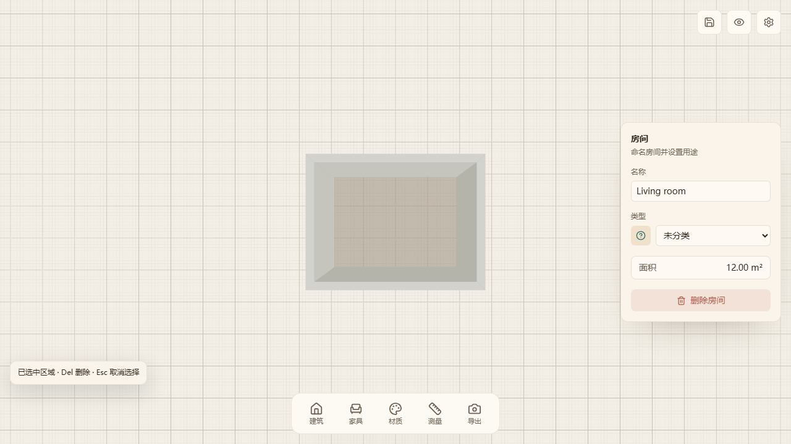

# V4 post-merge review fixes

Follow-up to the four review findings on PR #5, based on main `fc5549b`.

## Behavior

- Room names retain raw spaces during typing. Blur trims leading/trailing spaces and maps an empty name to null. Internal spaces remain intact.
- Delete handles zone-only selection using the same boundary-wall deletion semantics as the existing property-panel button.
- Delete processes every selected wall/vertex/zone in one document commit. Zone boundaries are resolved before any topology repair, including adjacent selected rooms with a shared wall.
- Vertex dragging returns raw preview and commit coordinates when viewport snapping is disabled, for both nearby grid points and endpoints.

## Regression evidence

Before the fix, all five new Chromium scenarios failed: sequential room-name typing, zone Delete, Shift-selected wall Delete, disabled grid snapping, and disabled endpoint snapping. Six focused unit assertions also failed on the original implementation.

The browser checks use real mouse/keyboard edits; debug instrumentation only seeds the document, camera and viewport configuration. Unit checks cover atomic commits, mixed/duplicate selection, adjacent zones, multiple vertices and preservation of unrelated walls.

The existing oblique-camera browser fixture now exits native pointer lock before changing the camera. Previously it only changed the UI store while native mouse movement could still rotate the camera.

Validation: 50 Vitest files / 255 tests; TypeScript project checks; production build. Browser acceptance includes 29 Chromium cases and three repeated oblique-camera checks.

## Scope and preservation

The fix is isolated from draft PR #6's undo/redo feature. The single replacement for bulk deletion is compatible with its history boundary. Work is in a separate `.worktrees/` checkout; the original root HEAD and 44 existing changed/untracked file entries remain intact.
